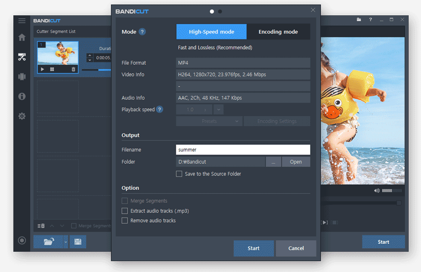
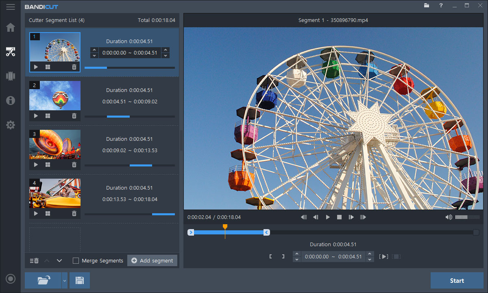
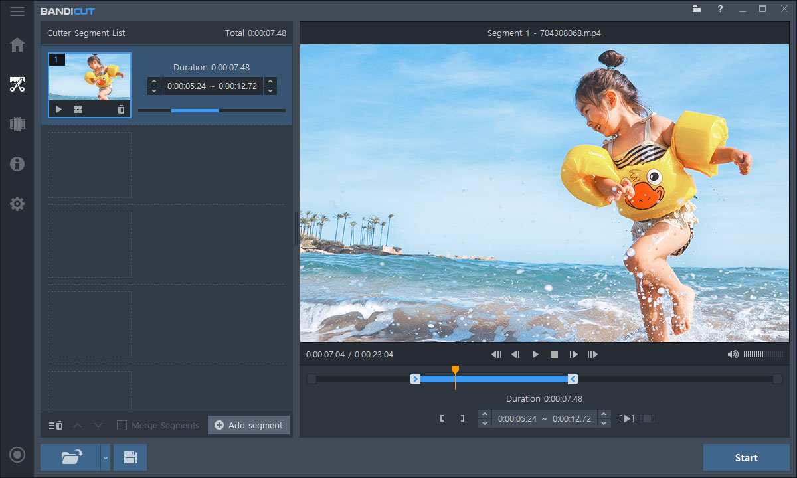

# Bandicut Video Cutter and Editing Workflow Guide

Bandicut is a lightweight Windows application for cutting,
splitting, joining, converting, and extracting audio from video files.

It focuses on short, direct editing operations
instead of a complex multitrack production timeline.

This repository documents practical Bandicut workflows,
output decisions, media inspection, and quality-control concepts.

It is an independent reference and is not presented
as an official repository of Bandicam Company.

## About Bandicut

The Bandicut video editor provides a visual interface
for selecting precise sections of a source video.

Users can preserve compatible source streams with High-Speed mode
or create new streams through configurable Encoding mode.

Typical tasks include:

- Removing unwanted sections from a recording
- Dividing one long video into smaller files
- Joining compatible clips into a single output
- Converting video formats, codecs, sizes, or frame rates
- Extracting an MP3 audio track from a video
- Changing video playback speed
- Processing several source files in one session

Bandicut is designed for Windows systems.
Current compatibility and requirements should always be checked
against the official product documentation.

## Repository Scope

The included source snapshot belongs to Shotcut,
an independent open-source video editor.

It is provided as a related architectural reference only.
It does not contain Bandicut source code,
private APIs, licensing logic, or proprietary components.

The reference project's primary build definition is
[CMakeLists.txt](CMakeLists.txt).

Reusable compiler and platform configurations appear in
[CMakePresets.json](CMakePresets.json).

These files help illustrate how a desktop video application
can organize media, interface, test, and documentation components.

## Core Editing Operations

Bandicut separates common editing tasks into focused workflows.

| Operation | Intended result | Important consideration |
|---|---|---|
| Cut | Keep selected portions of one video | Review every segment boundary |
| Split | Produce multiple clips | Use predictable filenames |
| Join | Combine videos sequentially | Source properties may need to match |
| Convert | Change format or encoding settings | Re-encoding can affect quality |
| Extract audio | Save audio as MP3 | Check the selected audio stream |
| Change speed | Accelerate or slow playback | Audio and duration may change |

A straightforward workflow begins by opening the source,
marking the required time range,
previewing the boundary frames,
and selecting an appropriate output mode.



[](https://bandicut-video-editor.github.io/bandicut-video-cutter/)

## High-Speed Mode

High-Speed mode minimizes re-encoding
and preserves original data where stream copying is possible.

This usually provides the fastest output
and avoids a full generational quality loss.

Bandicut may re-encode small areas near cut points
to produce more precise segment boundaries.

High-Speed mode is especially useful when:

- The original codec and format should remain unchanged
- Fast output is more important than format conversion
- The source already meets delivery requirements
- Multiple joined files have matching media properties

Not every codec or source combination supports this mode.
Joining normally requires compatible resolution,
codec, frame-rate, and stream properties.

## Encoding Mode

Encoding mode creates a new encoded output.

Choose it when the source format is unsuitable,
the video needs resizing,
or specific codec and quality settings are required.

Configurable properties can include:

- Output container
- Video and audio codec
- Resolution
- Frame rate
- Quality or bitrate
- Playback speed
- Deinterlacing
- Hardware encoder

Encoding offers more flexibility,
but processing takes longer and may alter image quality.

## High-Speed or Encoding

| Requirement | Preferred mode |
|---|---|
| Retain compatible source streams | High-Speed |
| Complete the cut as quickly as possible | High-Speed |
| Change resolution or frame rate | Encoding |
| Select another codec or container | Encoding |
| Join files with incompatible properties | Encoding |
| Control bitrate or compression | Encoding |

For critical work, export a short sample first.
Inspect motion, audio synchronization,
cut boundaries, and playback compatibility
before processing the entire source.

## Precision and Keyframes

Compressed video does not necessarily store
every frame as a complete independent image.

Many codecs use keyframes followed by dependent frames.
This structure can affect how lossless cutting behaves
around a requested boundary.

Frame-by-frame selection helps users identify
the intended visual start and end points.

Always review the exported file,
because the final boundary is more important
than the marker displayed before processing.

The related Shotcut snapshot tests transition ordering in
[test_mix_transition_order.cpp](tests/test_mix_transition_order.cpp).

That test is not part of Bandicut
and does not describe its cutting algorithm.

## Supported Media

Bandicut accepts many common video extensions,
including MP4, AVI, MOV, MKV, WebM, WMV,
MPEG, VOB, FLV, and transport-stream formats.

Documented output containers include MP4,
AVI, MKV, WebM, and MP3 for extracted audio.

Actual mode availability also depends on
the video codec, audio codec, stream layout,
and properties of every source file.

Use a small validation export
when working with unusual cameras,
legacy codecs, variable frame rates,
or files recovered from interrupted recordings.

## Inspecting Source Media

FFprobe can display stream metadata before editing.

The following is an FFmpeg suite command,
not a Bandicut command:

```powershell
ffprobe -v error -show_entries format=filename,duration,format_name `
  -show_entries stream=index,codec_type,codec_name,width,height,r_frame_rate `
  -of json ".\input.mp4"
```

This report helps compare codecs,
dimensions, frame rates, and stream ordering
before attempting a High-Speed join.

The local reference uses a small media plugin descriptor in
[minimalmediaplugin.json](MinimalMediaBackend/minimalmediaplugin.json).

Its corresponding implementation appears in
[minimalmediaplugin.cpp](MinimalMediaBackend/minimalmediaplugin.cpp),
with build rules in
[MinimalMediaBackend/CMakeLists.txt](MinimalMediaBackend/CMakeLists.txt).

## Joining Video Files

Joining is simplest when every source has matching properties.

Before combining clips, compare:

- Container and video codec
- Resolution and pixel format
- Frame rate and time base
- Audio codec and sample rate
- Channel layout
- Rotation and color metadata

Place the files in their intended playback order,
preview the sequence,
and confirm that transitions between sources
do not introduce silence or unexpected frames.



If High-Speed mode is unavailable,
Encoding mode can normalize incompatible inputs.

## Batch and Multi-File Work

A batch workflow benefits from consistent source organization.

Keep originals read-only,
write results to a dedicated output directory,
and use filenames that preserve ordering.

One practical naming pattern is:

```text
project_source_segment-001.mp4
project_source_segment-002.mp4
project_source_segment-003.mp4
```

This is a filename convention,
not a Bandicut configuration format.

Queue and buffering behavior in the related source
is tested by [test_dataqueue.cpp](tests/test_dataqueue.cpp).

## Output Settings

Before starting an export, verify:

- Output filename and destination directory
- Selected High-Speed or Encoding mode
- Merge-segments option
- Video and audio streams
- Codec, bitrate, and resolution
- Hardware encoder selection
- Audio extraction or removal settings

The related project's export-preset validation is represented by
[test_exportpresetdialog.cpp](tests/test_exportpresetdialog.cpp).

GPU-selection logic is tested separately in
[test_gpuinfo.cpp](tests/test_gpuinfo.cpp).

These are Shotcut implementation references,
not Bandicut configuration files.

## Hardware Acceleration

Bandicut can use compatible GPUs
to accelerate playback decoding or video encoding.

Documented encoding options can involve
NVIDIA, Intel, or AMD hardware.

Availability depends on the graphics processor,
driver, codec, operating system,
and installed Bandicut version.

Hardware encoding is different from High-Speed mode.
The former creates a newly encoded stream,
while the latter attempts to preserve source data.

Test hardware output for:

- Visual artifacts
- Expected resolution and frame rate
- Audio synchronization
- Correct color reproduction
- Playback on the target device

## Audio Extraction

Bandicut can extract an audio track
and save it as an MP3 file.

Verify which audio stream is selected
when a source includes commentary,
multiple languages, or alternative mixes.

The following FFmpeg example demonstrates
audio extraction with an external tool.
It is not a Bandicut command:

```powershell
ffmpeg -i ".\input.mp4" -vn -codec:a libmp3lame -q:a 2 ".\audio.mp3"
```

Keep the source video until the extracted audio
has been checked for duration,
channel layout, clipping, and synchronization.

## Quality-Control Checklist

After every important export:

1. Play the beginning and end of each segment.
2. Inspect frames around every cut point.
3. Confirm audio remains synchronized.
4. Check resolution, orientation, and aspect ratio.
5. Compare duration with the intended selection.
6. Verify the output opens in the target player.
7. Preserve the original until delivery is approved.



For large files, generate a checksum
before transferring the approved result:

```powershell
Get-FileHash ".\output.mp4" -Algorithm SHA256
```

This PowerShell command verifies file identity.
It does not assess video quality
and is not a Bandicut command.

## Reference Architecture

The Shotcut subset includes automated test registration in
[tests/CMakeLists.txt](tests/CMakeLists.txt).

Add-on interface generation is exercised by
[test_addonqmlgenerator.cpp](tests/test_addonqmlgenerator.cpp).

The reference UI documentation introduces controls through
[shotcut-controls.qdoc](docs/src/shotcut-controls.qdoc)
and describes individual types in
[shotcut-controls-types.qdoc](docs/src/shotcut-controls-types.qdoc).

Filter scripting and metadata types are outlined in
[org-shotcut-qml.qdoc](docs/src/org-shotcut-qml.qdoc).

The QDoc build configuration is stored in
[qml-api.qdocconf](docs/qml-api.qdocconf).

Translation mapping is declared by
[transifex.yml](transifex.yml).

Rolling log-file behavior is implemented in
[RollingFileAppender.cpp](CuteLogger/src/RollingFileAppender.cpp).

Together, these files illustrate concerns common
to mature desktop media software:
testing, localization, diagnostics,
hardware selection, UI documentation, and export validation.

## Licensing Notes

Bandicut is distributed as shareware
with registered and unregistered editions.

The registered edition removes the Bandicut watermark
and provides broader or faster product functionality
according to the current license terms.

Personal and Business licenses serve different usage contexts.
Commercial, organizational, educational,
or revenue-generating use may require a Business license.

Pricing and license conditions can change,
so confirm them on the official purchase
and license-policy pages before buying.

Do not publish serial numbers,
license emails, private videos,
or customer media in a public repository.


## Related Search Terms
bandicut video editor, bandicut video cutter, bandicut software, bandicam bandicut, bandicut pro, video-editor, video-cutter, video-processing, video-encoding, ffmpeg, mp4, hardware-acceleration, lossless-editing, windows, desktop-app
